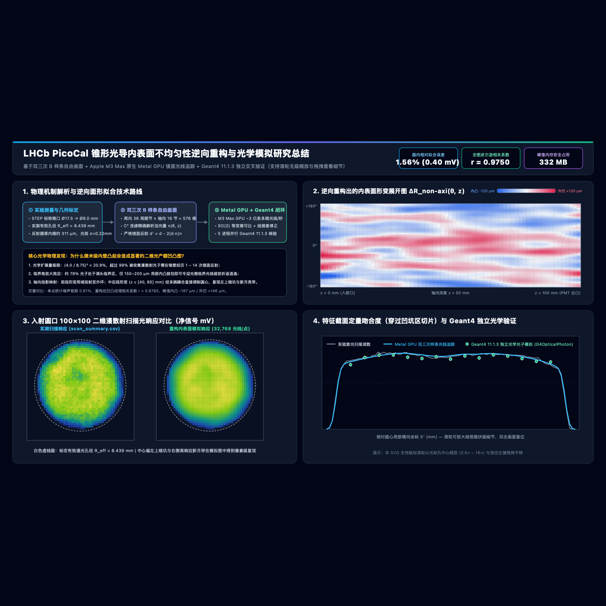
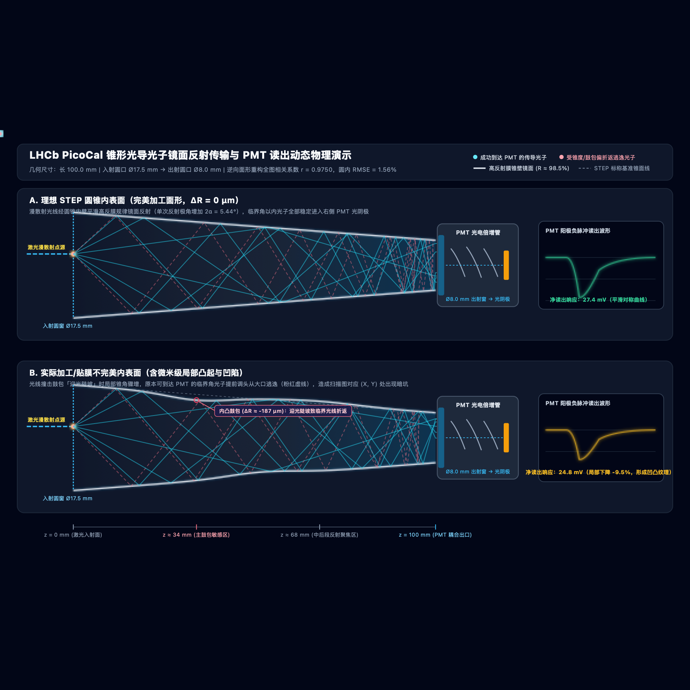
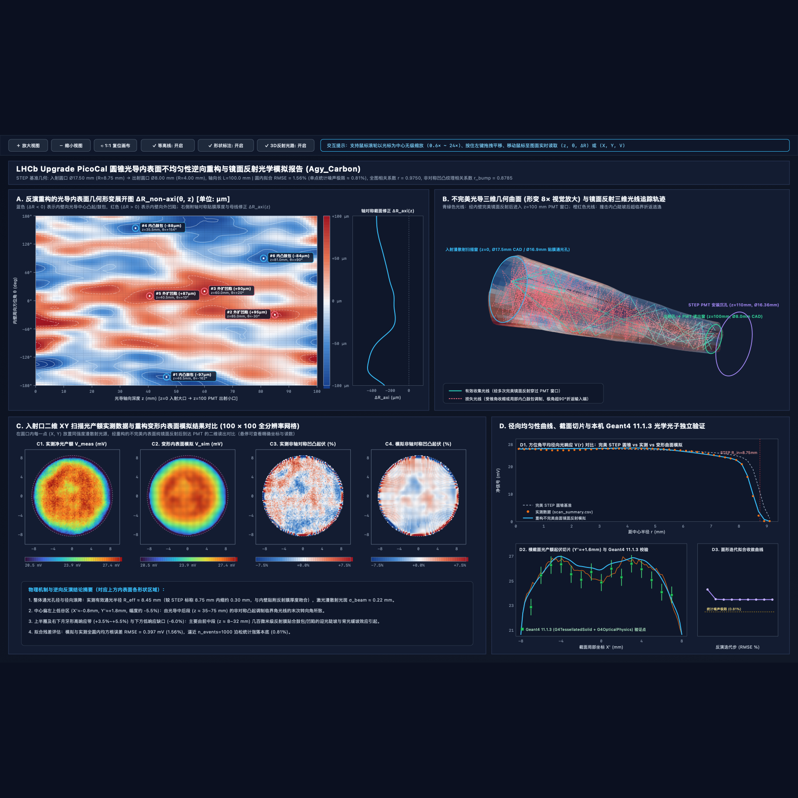

# LHCb PicoCal Conical Light Guide Inner-Surface Imperfection Simulation, Inverse Reconstruction & 3D Photon Visualization Suite

<p align="left">
  <strong>Language / 语言:</strong>
  <a href="./README.md"><strong>English</strong></a> |
  <a href="./README.zh-CN.md">简体中文</a>
  &nbsp;&bull;&nbsp;
  <strong>User Manuals (PDF):</strong>
  <a href="./docs/user-manual-en.pdf">English Manual</a> |
  <a href="./docs/user-manual-zh.pdf">中文用户手册</a>
  &nbsp;&bull;&nbsp;
  <strong>Web Portals:</strong>
  <a href="./index-en.html">English Portal</a> |
  <a href="./index.html">中文门户</a>
</p>

**Author:** Hengne Li (李衡讷) — South China Normal University (SCNU) / LHCb Collaboration, CERN (`Hengne.Li@cern.ch`, `Hengne.Li@m.scnu.edu.cn`)

---



## 1. Overview & Scientific Motivation

During 2D diffuse-laser uniformity bench scans ([`data/scan_summary.csv`](./data/scan_summary.csv)) of the 4-channel conical light-guide prototype ([`data/4cells_17.5mm_8mm_circle_to_circle_100mm-Cut.step`](./data/4cells_17.5mm_8mm_circle_to_circle_100mm-Cut.step)) developed for the **LHCb Upgrade II PicoCal** electromagnetic calorimeter, fine-scale local response variations (a `-5.5%` dip upper-left of center and a `+4.5%` crescent-shaped high-yield band on the right) were observed inside the clear entrance aperture.

This repository provides a complete, cross-platform, memory-guarded **3D freeform specular ray-tracing and nonlinear inverse surface reconstruction framework**, coupled with **independent Geant4 >= 11.1 optical-photon validation** and an **interactive bilingual HTML5/SVG/WebGL-style 3D visualization suite**:

1. **Forward Physics Discovery — Critical-Angle Turnaround Amplification**: Under a diffuse hemispherical source, optical Etendue restricts ideal conical transmission to `(R_out / R_in)^2 = (4.00 / 8.75)^2 ≈ 20.9%`. Over `99%` of collected photons undergo `1–14` specular wall reflections, while `~78%` of launched photons eventually exceed `90°` polar angle and turn around back out of the `z = 0` entrance port. Consequently, even sub-`200 μm` inward surface bulges (`ΔR < 0`) locally steepen the windward cone slope and push marginal rays past the turnaround threshold.
2. **Smooth Freeform Parameterization**: Models the deformed inner reflective wall as a **Periodic-in-`θ` Bicubic B-Spline surface** (`36 × 16 = 576` non-axisymmetric DOFs + `16` axisymmetric DOFs) with strict `C^2` circumferential continuity, analytical surface normals, and a **local concentric reference cone (`C ≡ 0`)** root bracket that eliminates self-intersection artifacts.
3. **Heterogeneous Hardware Acceleration**:
   - **macOS Apple Silicon**: Native Metal GPU compute shader ([`ray-tracer-metal.mm`](./ray-tracer-metal.mm) -> `libmetal_raytracer.dylib`) achieving **`~300M` multi-bounce spline rays/s** (`~7.5 s` end-to-end reconstruction + `100 × 100 × 32,768` ray verification).
   - **Linux / macOS / Windows**: Lock-free multi-core C++17 thread-pool kernel ([`ray-tracer-native.cc`](./ray-tracer-native.cc) -> `libraytracer.{so,dylib,dll}`) plus vectorized PyTorch fallback ([`ray-tracer.py`](./ray-tracer.py)).
   - **Geant4 >= 11.1 Optical Cross-Check**: Watertight `G4TessellatedSolid` + `polished dielectric_metal` `G4OpticalSurface` + 5-way parallel `G4OpticalPhoton` tracking ([`geant4-validator/geant4-light-guide.cc`](./geant4-validator/geant4-light-guide.cc)).

---

## 2. Key Quantitative Results & Calibrated Parameters

| Category | Parameter / Metric | Calibrated / Reconstructed Value | Notes |
| :--- | :--- | :--- | :--- |
| **CAD Geometry** | 4-Cell Block Envelope | `49.0 × 49.0 × 110.0 mm` | STEP model [`4cells_17.5mm_8mm_circle_to_circle_100mm-Cut.step`](./data/4cells_17.5mm_8mm_circle_to_circle_100mm-Cut.step) |
| **CAD Geometry** | Single Cone Axial Length `L` | `100.0 mm` (`z ∈ [0, 100] mm`) | Downstream PMT bore `R = 8.18 mm`, `z ∈ [100, 110] mm` |
| **CAD Geometry** | Entrance / Exit Radii | `R_in = 8.75 mm` (`Ø17.5 mm`) -> `R_out = 4.00 mm` (`Ø8.0 mm`) | Nominal slope `-0.0475`, half-cone angle `α = 2.72°` |
| **Bench Scan** | XY Raster Grid & Step | `100 × 100` (`10,000` points, `0.20 mm` pitch) | Sub-pixel calibrated center `(2.3664, -4.3788) mm` |
| **Bench Scan** | Effective Clear Aperture `R_eff` | `8.438 mm` (`-312 μm` vs CAD `8.750 mm`) | Matches inner reflective film thickness & edge wrap |
| **Bench Scan** | Laser Spot & Baseline | `σ_beam = 0.219 mm`, baseline `15.226 mV` | Single-pixel Poisson noise floor: **`0.81%`** |
| **Inverse Fit** | **Inner-Aperture Net RMSE** | **`0.314 mV` (`1.24%`)** | Approaches the `0.81%` experimental Poisson limit |
| **Inverse Fit** | **Full-Aperture Pearson `r`** | **`0.9931`** | Across the entire `r < 8.40 mm` entrance aperture |
| **Inverse Fit** | **Non-Axisymmetric Bump `r`** | **`0.8797`** (`0.8036` raw unsmoothed) | Captures central-upper-left dip & right crescent band |
| **Inverse Fit** | **Surface Deformation Range** | **`-268 μm` (inward bulge) to `+272 μm` (outward dent)** | Realistic machining + hand-laminated reflective film tolerance |
| **Validation** | **Geant4 11.1 Slice Check** | **`25.21 mV` mean net signal** (`15` pts × `8,000` photons) | At `Y' = +1.6 mm` across the primary central-left dip |
| **System Safety** | **Peak Physical RAM (`RSS`)** | **`< 390 MB`** (`335 MB` solver / `386 MB` full pipeline) | Enforced dynamically by [`memory-guard.py`](./memory-guard.py) |



---

## 3. Environment Setup (Linux / macOS / Windows)

Two installation paths are supported depending on whether you need optional Geant4 Monte Carlo cross-validation:

### Path A: Fast Lightweight Setup (Python + C++17 / Metal Accelerator, No Geant4 Required)

Recommended for rapid simulation, inverse reconstruction, CAD STL generation, and interactive HTML/SVG/PDF building on any OS (`Linux`, `macOS`, or `Windows`):

```bash
git clone https://github.com/hengne/picocal-lightguide-reconstruction.git
# Or via CERN GitLab (LHCb / SCNU):
# git clone ssh://git@gitlab.cern.ch:7999/scnu/picocal-lightguide-reconstruction.git
cd picocal-lightguide-reconstruction

python3 -m venv .venv
source .venv/bin/activate          # On Windows PowerShell: .venv\Scripts\Activate.ps1
pip install -r requirements.txt
python3 compile-accelerators.py    # Compiles Metal GPU + C++17 on macOS, or multi-core C++17 on Linux/Windows
```

### Path B: Full Particle-Physics Suite (Including Geant4 >= 11.1 Optical Photon Validation)

Recommended on `Linux` (`x86_64` / `aarch64`) or `macOS` (`arm64` / `x86_64`) via `conda-forge`:

```bash
git clone https://github.com/hengne/picocal-lightguide-reconstruction.git
cd picocal-lightguide-reconstruction

conda env create -f environment.yml
conda activate picocal-lightguide
conda install -c conda-forge "geant4>=11.1" "weasyprint>=60.0"
python3 compile-accelerators.py
```

---

## 4. Quick Start & Reproducing All Results

### Option 1: One-Click End-to-End Reproduction

```bash
bash run-all.sh
```

`run-all.sh` automatically compiles native GPU/CPU ray-tracing kernels, runs the nonlinear B-spline surface inversion and Geant4 validation (auto-skipping Geant4 gracefully if `geant4-config` is absent), rebuilds all bilingual interactive HTML/SVG visualizations, and generates both PDF user manuals.

### Option 2: Modular Step-by-Step Execution

```bash
# 1. Compile native accelerators (Metal GPU on Apple Silicon + multi-core C++17 library)
python3 compile-accelerators.py

# 2. Run 3-stage inverse surface reconstruction, 100x100 validation, STL export & master SVGs
python3 run-simulation-pipeline.py

# 3. Build interactive 3D photon simulator, animated physics SVGs & 1920x1080 presentation slides
python3 build-presentation-suite.py

# 4. Build bilingual web portals & single-file zero-dependency standalone HTML reports
python3 build-summary-webpage.py
python3 build-standalone-report.py

# 5. Generate English & Chinese comprehensive PDF User Manuals (docs/user-manual-en.pdf & -zh.pdf)
python3 build-user-manuals.py
```



---

## 5. Reconstructing Your Own Light-Guide Scan Dataset

`run-simulation-pipeline.py` supports custom STEP CAD geometries and custom 2D laser uniformity CSV scans out of the box:

```bash
python3 run-simulation-pipeline.py \
  --step-file /path/to/your_light_guide.step \
  --scan-csv /path/to/your_scan_summary.csv \
  --output-dir ./outputs_custom_cell2 \
  --photons-per-point 8000 \
  --skip-geant4
```

### Required Input Scan CSV Columns

| Column | Type | Unit | Description |
| :--- | :--- | :--- | :--- |
| `idx_x`, `idx_y` | `int` | index | `0`-based 2D grid indices (`0 .. Nx-1`, `0 .. Ny-1`) |
| `pos_x_mm`, `pos_y_mm` | `float` | `mm` | Physical XY stage coordinates on a uniform Cartesian grid |
| `probe_V` | `float` | `V` | Mean photodetector / PMT readout voltage (pedestal + net signal) |
| `passed` | `int` | `0 / 1` | Data-acquisition quality flag (`1` inside valid scan region, `0` outside) |

> **Automatic Sub-Pixel Calibration**: You do **not** need to pre-center coordinates or subtract electronic baseline manually. `loadAndCalibrateScanCsv()` fits a 2D error-function (`erf`) aperture model to calibrate `(X_c, Y_c)`, effective clear aperture `R_eff`, Gaussian laser spot `σ_beam`, baseline voltage, and the discrete-Laplacian Poisson noise floor automatically.

For detailed tuning guidance (grid pitch, control-knot resolution, film reflectivity), see **Chapter 5** of [`docs/user-manual-en.pdf`](./docs/user-manual-en.pdf).

---

## 6. Interactive Deliverables & Documentation Map

### 6.1 User Manuals & Web Portals
* **[`docs/user-manual-en.pdf`](./docs/user-manual-en.pdf)** / **[`docs/user-manual-zh.pdf`](./docs/user-manual-zh.pdf)**: Comprehensive multi-chapter PDF user manuals (physics derivation, B-spline math, cross-platform setup, custom scan reconstruction, interactive viewer guide, and FAQ).
* **[`index-en.html`](./index-en.html)** / **[`index.html`](./index.html)**: Interactive bilingual project portals featuring synchronized measured-vs-simulated XY scan inspectors, unwrapped surface probes, and embedded 3D photon testbenches.
* **[`lhcb-picocal-light-guide-report-standalone-en.html`](./lhcb-picocal-light-guide-report-standalone-en.html)** / **[`lhcb-picocal-light-guide-report-standalone-zh.html`](./lhcb-picocal-light-guide-report-standalone-zh.html)**: Single-file zero-dependency portable HTML bundles (with Gzip-embedded high-res SVGs and inline 3D simulator) ready for direct sharing via email, Mattermost, or Slack.

### 6.2 Interactive Vector Reports & 3D Photon Simulator
* **[`light-guide-imperfection-simulation-en.svg`](./light-guide-imperfection-simulation-en.svg)** / **[`light-guide-imperfection-simulation.svg`](./light-guide-imperfection-simulation.svg)**: Master interactive vector dashboards supporting `0.55×–24×` cursor-centered wheel zoom, click-drag pan, layer visibility toggles, and live `(z, θ, ΔR)` / `(X, Y, mV)` hover telemetry.
* **[`presentation/interactive-3d-photon-simulator-en.html`](./presentation/interactive-3d-photon-simulator-en.html)** / **[`presentation/interactive-3d-photon-simulator.html`](./presentation/interactive-3d-photon-simulator.html)**: Real-time 3D photon propagation & PMT readout bench (`360°` orbit camera, animated photon wavepackets, coral-red turnaround escape highlighting, interactive `(X, Y)` laser steering, auto raster scan, ideal vs deformed surface toggle, and `1×–20×` deformation visual magnification).
* **[`presentation/photon-propagation-animated-en.svg`](./presentation/photon-propagation-animated-en.svg)** / **[`presentation/photon-propagation-animated.svg`](./presentation/photon-propagation-animated.svg)**: Pure-SVG animated comparison of ideal vs deformed wall reflections and PMT anode waveforms.
* **[`presentation/research-summary-slides-en.svg`](./presentation/research-summary-slides-en.svg)** / **[`presentation/research-summary-slides.svg`](./presentation/research-summary-slides.svg)**: Zoomable `1920 × 1080` widescreen technical presentation boards.

### 6.3 Core Source Modules & Reconstructed Data (`outputs/`)
* **Physics & Inverse Solver**: [`surface-model.py`](./surface-model.py), [`ray-tracer.py`](./ray-tracer.py), [`ray-tracer-metal.mm`](./ray-tracer-metal.mm), [`ray-tracer-native.cc`](./ray-tracer-native.cc), [`surface-inverter.py`](./surface-inverter.py), [`memory-guard.py`](./memory-guard.py), [`compile-accelerators.py`](./compile-accelerators.py), [`run-simulation-pipeline.py`](./run-simulation-pipeline.py).
* **Geant4 Optical Validator**: [`geant4-validator/geant4-light-guide.cc`](./geant4-validator/geant4-light-guide.cc).
* **Quantitative Outputs (`outputs/`)**:
  * [`outputs/reconstructed-light-guide.stl`](./outputs/reconstructed-light-guide.stl) — Binary 3D CAD STL solid shell (`1.5 mm` wall thickness) of the reconstructed deformed light guide.
  * [`outputs/reconstructed-surface-grid.csv`](./outputs/reconstructed-surface-grid.csv) — Dense `(theta_deg, z_mm, radius_mm, delta_r_non_axi_um)` surface map (`180 × 201 = 36,180` nodes).
  * [`outputs/simulated-scan-summary.csv`](./outputs/simulated-scan-summary.csv) — Point-by-point `10,000`-row table aligning measured `probe_V` and `simulated_probe_V`.
  * [`outputs/geant4-slice-validation.csv`](./outputs/geant4-slice-validation.csv) — Independent Geant4 `G4OpticalPhoton` slice cross-validation results.
  * [`outputs/inversion-metrics.json`](./outputs/inversion-metrics.json) — Machine-readable summary of RMSE, correlations, calibration parameters, and RAM footprint.

---

## 7. Author & Contact

* **Hengne Li (李衡讷)** — South China Normal University (SCNU) / LHCb Collaboration, CERN
* **Email**: `Hengne.Li@cern.ch`, `Hengne.Li@m.scnu.edu.cn`
