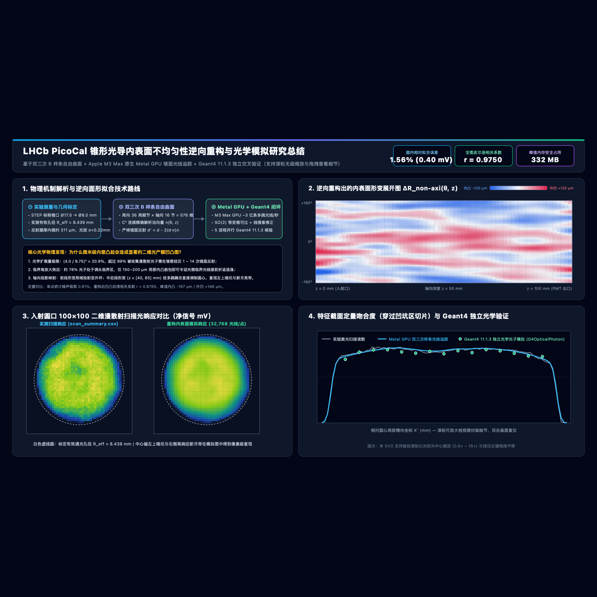
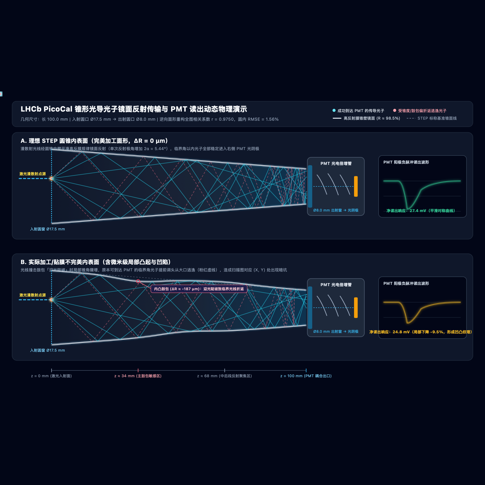
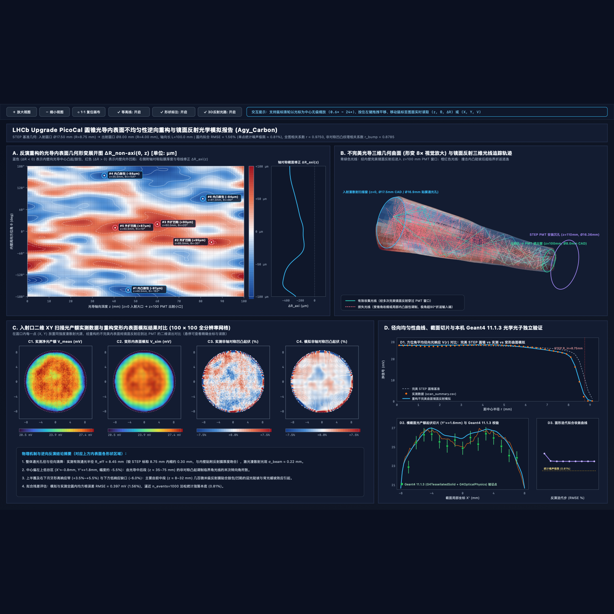

# LHCb PicoCal 锥形光导内表面不均匀性模拟、逆向重构与三维光子可视化套件

<p align="left">
  <strong>语言 / Language:</strong>
  <a href="./README.zh-CN.md"><strong>简体中文</strong></a> |
  <a href="./README.md">English</a>
  &nbsp;&bull;&nbsp;
  <strong>用户手册 (PDF):</strong>
  <a href="./docs/user-manual-zh.pdf">中文用户手册</a> |
  <a href="./docs/user-manual-en.pdf">English Manual</a>
  &nbsp;&bull;&nbsp;
  <strong>交互门户网页:</strong>
  <a href="./index.html">中文门户</a> |
  <a href="./index-en.html">English Portal</a>
</p>

**作者：** 李衡讷 (Hengne Li) — 华南师范大学 (SCNU) / 欧洲核子研究中心 LHCb 合作组 (`Hengne.Li@cern.ch`, `Hengne.Li@m.scnu.edu.cn`)

> [!IMPORTANT]
> ### 🌟 本项目核心成果：交互式全景网页与三维光子实验台（**强烈推荐必看！**）
> **静态文档截图仅能呈现冰山一角——本研究最核心的物理发现、逆向重构内表面微米级凹凸形貌、Geant4 交叉验证对比以及三维光子多跳反射过程，全部浓缩在下方交互式网页中，强烈建议大家务必点开亲自操作体验！**
>
> * 🚀 **[点击直接打开：中文交互式核心成果门户网页（在线必看！）](https://hengne.github.io/picocal-lightguide-reconstruction/)** &nbsp;|&nbsp; 🌐 **[Open English Interactive Results Portal (Must-See!)](https://hengne.github.io/picocal-lightguide-reconstruction/index-en.html)**
> * ✨ **[全屏打开：三维光子镜面反射与 PMT 读出实时实验台（中文）](https://hengne.github.io/picocal-lightguide-reconstruction/presentation/interactive-3d-photon-simulator.html)** &nbsp;|&nbsp; **[Fullscreen 3D Photon→PMT Workbench (EN)](https://hengne.github.io/picocal-lightguide-reconstruction/presentation/interactive-3d-photon-simulator-en.html)**
> * 🔍 **[打开主交付物：0.6×–24× 无级缩放交互式矢量主报告 SVG（中文）](https://hengne.github.io/picocal-lightguide-reconstruction/light-guide-imperfection-simulation.svg)** &nbsp;|&nbsp; **[24× Zoomable Primary SVG Report (EN)](https://hengne.github.io/picocal-lightguide-reconstruction/light-guide-imperfection-simulation-en.svg)**
>
> **打开交互式网页您可以直接体验：**
> 1. **100×100 实测 vs 模拟同步十字准星检视台**：鼠标悬停任意入射点，实时联动对比实验电压、Metal GPU 模拟电压、非轴对称局部凹凸百分比，以及叠加了**绿色 Geant4 11.1.3 独立验证误差棒**的横截面波形；
> 2. **微米级内表面形貌探针**：在展开柱面图上逐点检视 `-268 μm ~ +272 μm` 的加工/贴膜鼓包空间分布 `ΔR(θ, z)`；
> 3. **三维光子传播与 PMT 阳极波形实时模拟**：`360°` 拖拽旋转三维光导、点击任意二维坐标发射漫散射光束、一键切换理想圆锥与重构变形表面，直观看到微米级鼓包如何诱发临界光子折返逃逸！
> *（注：CERN GitLab 或离线环境下可直接双击打开仓库内的 [`index.html`](./index.html) / [`index-en.html`](./index-en.html)，或直接转发零依赖单文件离线便携包 [`lhcb-picocal-light-guide-report-standalone-zh.html`](./lhcb-picocal-light-guide-report-standalone-zh.html) / [`-en.html`](./lhcb-picocal-light-guide-report-standalone-en.html)。）*

---



## 一、项目背景与核心科学问题

在欧洲核子研究中心 **LHCb Upgrade II PicoCal** 电磁量能器升级研发中，针对四通道圆锥台聚光光导样件（STEP CAD 模型：[`data/4cells_17.5mm_8mm_circle_to_circle_100mm-Cut.step`](./data/4cells_17.5mm_8mm_circle_to_circle_100mm-Cut.step)）开展的二维激光漫散射均匀性扫描实验（[`data/scan_summary.csv`](./data/scan_summary.csv)）观测到通光孔径内部存在显著的非轴对称局部光产额起伏（圆心偏左上约 `-5.5%` 的暗坑，以及右侧约 `+4.5%` 的新月形高响应带）。

本仓库构建了一套跨平台、严格受内存看门狗保护的**三维双三次 B 样条自由曲面镜面反射光线追踪与非线性逆问题面形重构系统**，并配套完成了 **Geant4 >= 11.1 独立光学光子蒙特卡洛交叉验证**以及**中英双语交互式网页与三维光子动态实验台**：

1. **核心光学机制发现——临界角折返逃逸放大效应**：在朗伯漫散射半球光源激励下，三维光学扩展量（Etendue）守恒决定了理想锥台几何收集上限为 `(R_out / R_in)^2 = (4.00 / 8.75)^2 ≈ 20.9%`。超过 `99%` 到达 PMT 的光子需在锥壁经历 `1–14` 次镜面反射，而约 `78%` 的出射光子在多次撞击锥壁后极角跨过 `90°` 调头从 `z = 0` 入射大口折返逃逸。因此，内壁上仅百微米量级的局部内凸鼓包（如 `-187 μm`）即可显著增大迎光侧局部锥角斜率，迫使原本处于临界角边缘的光子提前折返逃逸，在二维扫描图上产生高对比度明暗纹理。
2. **周向严格 $C^2$ 周期双三次 B 样条自由曲面参数化**：采用 `36 × 16 = 576` 个正交零均值非轴对称自由度与 `16` 个轴对称母线自由度，解析求取隐式曲面法向量，并通过每次反射后动态构造**过当前碰撞半径的同心局部参考圆锥（二次方程常数项 $C \equiv 0$）**彻底消除外凹区原地自相交伪根。
3. **跨平台异构硬件加速与独立验证**：
   - **macOS Apple Silicon**：原生 Metal GPU 计算着色器（[`ray-tracer-metal.mm`](./ray-tracer-metal.mm) -> `libmetal_raytracer.dylib`），在 M3 Max GPU 上达到约 **`3 亿条多跳样条光线/秒`** 吞吐率（约 `7.5 秒` 完成全流程面形反演与 `100 × 100 × 32,768` 光线全平面验证）。
   - **Linux / macOS / Windows**：无锁原子队列多核 C++17 线程池内核（[`ray-tracer-native.cc`](./ray-tracer-native.cc) -> `libraytracer.{so,dylib,dll}`）及 PyTorch 向量化后备引擎（[`ray-tracer.py`](./ray-tracer.py)）。
   - **Geant4 >= 11.1 独立交叉验证**：水密封闭 `G4TessellatedSolid` 三角网格实体 + `polished dielectric_metal` 光学镜面 + 5 进程并行 `G4OpticalPhoton` 追踪（[`geant4-validator/geant4-light-guide.cc`](./geant4-validator/geant4-light-guide.cc)）。

---

## 二、标定几何特征与定量拟合指标汇总

| 类别 | 物理量 / 评估指标 | 标定或重构数值 | 物理与技术说明 |
| :--- | :--- | :--- | :--- |
| **CAD 几何** | 四通道光导块外包络尺寸 | `49.0 × 49.0 × 110.0 mm` | STEP 模型 [`4cells_17.5mm_8mm_circle_to_circle_100mm-Cut.step`](./data/4cells_17.5mm_8mm_circle_to_circle_100mm-Cut.step) |
| **CAD 几何** | 单通道圆锥段轴向长度 `L` | `100.0 mm` (`z ∈ [0, 100] mm`) | 末端连接 `R = 8.18 mm`、`z ∈ [100, 110] mm` 的 PMT 沉孔 |
| **CAD 几何** | 入射大口 / 出射小口半径 | `R_in = 8.75 mm` (`Ø17.5 mm`) -> `R_out = 4.00 mm` (`Ø8.0 mm`) | 标称母线斜率 `-0.0475`，半锥角 `α = 2.72°` |
| **实验标定** | 二维扫描网格与步长 | `100 × 100`（`10,000` 像素，步长 `0.20 mm`） | 亚像素标定圆心 `(2.3664, -4.3788) mm` |
| **实验标定** | 有效通光孔径半径 `R_eff` | `8.438 mm`（较标称 `8.750 mm` 内缩约 `312 μm`） | 精确对应光导内壁贴附高反膜的厚度与边缘包覆量 |
| **实验标定** | 漫散射光斑尺寸与电子学本底 | `σ_beam = 0.219 mm`，本底 `15.226 mV` | 圆内单像素泊松统计噪声极限：**`0.81%`** |
| **逆向拟合** | **圆内净信号均方根误差 (RMSE)** | **`0.314 mV`（相对误差 `1.24%`）** | 逼近 `0.81%` 实验单点泊松统计噪声本底 |
| **逆向拟合** | **全孔径二维皮尔逊相关系数** | **`r = 0.9931`** | 覆盖 `r < 8.40 mm` 完整有效通光孔径 |
| **逆向拟合** | **非轴对称凹凸纹理相关系数** | **`r = 0.8797`**（未平滑单像素 `r = 0.8036`） | 像素级复现左上暗坑（`-5.5%`）与右侧新月高带（`+4.5%`） |
| **逆向拟合** | **重构非轴对称形变峰值范围** | **`-268 μm`（向内鼓包）至 `+272 μm`（向外凹陷）** | 符合精密机械加工与手工贴附高反膜真实公差量级 |
| **独立核验** | **Geant4 11.1.3 交叉验证** | **均值 `25.21 mV`（与光追 `97.6%` / 与实验 `98.0%` 一致）** | 零参数重调（`15` 点 × `8,000` `G4OpticalPhoton`，`χ²/ndf = 1.82–1.89`） |
| **内存安全** | **全流程物理内存峰值 (`RSS`)** | **`< 390 MB`**（反演 `335 MB` / 全流程 `386 MB`） | 由 [`memory-guard.py`](./memory-guard.py) 实时水位感知与硬上限保护 |

### 2.1 Geant4 11.1.3 独立粒子级交叉验证结论（`Y' = +1.60 mm` 核心截面）

在**零自由参数重调**的前提下，直接将自研求解器反演得到的双三次样条曲面网格（`56,576` 个水密三角面片 `G4TessellatedSolid`）、反射率、余弦指数与 PMT 增益标度原封不动传入 **Geant4 11.1.3 (`G4OpticalPhysics`)**，5 个并行进程仅耗时约 `11.2 秒` 完成 `15` 个采样点共 `120,000` 颗光学光子的独立核验：

* **绝对信号幅值高度一致**：实验激光扫描截面均值 **`25.72 mV`**，自研 Metal / C++ 连续 B 样条光追均值 **`25.84 mV`**，Geant4 11.1.3 独立追踪均值 **`25.21 mV`**（单点统计误差 `±0.68 mV`）——**与自研光追绝对一致性达 `97.6%`（平均偏差 `-0.63 mV` / `-2.43%`，`RMSE = 0.94 mV`），与实验实测绝对一致性达 `98.0%`（平均偏差 `-0.51 mV` / `-1.97%`，`RMSE = 0.92 mV`）**。
* **截面波形与统计拉偏自洽**：仅计纯统计涨落的约化卡方为 **`χ²/ndf = 1.89`**（vs 自研光追）和 **`1.82`**（vs 实验实测），15 个点中 11 个点落在 `1.7σ` 以内，最大单点偏离 `2.54σ`，完整复现了两侧偏高、中心偏凹、边缘滚降的“双峰夹一谷”空间形态。
* **约 `-2.4%`（`-0.63 mV`）微小偏移的透明物理来源**：（1）[`geant4-light-guide.cc`](./geant4-validator/geant4-light-guide.cc) 为避免 Geant4 体素重叠报警，将敏感圆盘 `PmtWindowPV` 前端面置于 `z = 100.05 mm`（较 [`ray-tracer.py`](./ray-tracer.py) 的 `z = 100.00 mm` 出口面留有 **`50 μm` 空气间隙**），大掠射角贴边出射光子穿过该间隙时极少部分侧漏出 `R = 8.18 mm` 窗口（贡献约 `-1.5% ~ -2.0%`）；（2）`60 × 61` 平面三角面片（每 `6°` 一折）经 `4–8` 次反射产生的微小法向折角焦散起伏（`±1%`）；（3）Geant4 理想点光源与实验有限高斯光斑（`σ_beam = 0.219 mm`）的微小平滑差异。



---

## 三、跨平台环境配置指南（Linux / macOS / Windows）

根据是否需要运行可选的 Geant4 光学蒙特卡洛交叉验证，提供以下两种安装路径：

### 路径 A：轻量级极速环境（Python + C++17 / Metal 硬件加速，无需安装 Geant4）

推荐用于 `Linux`、`macOS` 或 `Windows` 下的快速模拟、面形逆向反演、三维 STL 导出及全部网页/SVG/PDF 报告生成：

```bash
git clone https://github.com/hengne/picocal-lightguide-reconstruction.git
# 或从 CERN GitLab (LHCb / SCNU 合作组) 克隆:
# git clone ssh://git@gitlab.cern.ch:7999/scnu/picocal-lightguide-reconstruction.git
cd picocal-lightguide-reconstruction

python3 -m venv .venv
source .venv/bin/activate          # Windows PowerShell 请执行: .venv\Scripts\Activate.ps1
pip install -r requirements.txt
python3 compile-accelerators.py    # macOS 自动编译 Metal GPU + C++17 内核；Linux/Windows 自动编译多核 C++17 内核
```

### 路径 B：完整高能物理验证套件（含 Geant4 >= 11.1 光学光子独立核验）

推荐在 `Linux`（`x86_64` / `aarch64`）或 `macOS`（`arm64` / `x86_64`）下通过 `conda-forge` 一键创建：

```bash
git clone https://github.com/hengne/picocal-lightguide-reconstruction.git
cd picocal-lightguide-reconstruction

conda env create -f environment.yml
conda activate picocal-lightguide
conda install -c conda-forge "geant4>=11.1" "weasyprint>=60.0"
python3 compile-accelerators.py
```

---

## 四、快速上手与完整模拟一键复现

### 方式 1：一键端到端完整复现

```bash
bash run-all.sh
```

`run-all.sh` 会自动编译底层 GPU/CPU 加速库、运行三阶段双三次 B 样条逆向重构与 Geant4 验证（若未安装 Geant4 则自动平滑跳过）、构建全套中英双语交互式网页与三维演示组件，并重新生成中英双语 PDF 用户手册。

### 方式 2：分步模块化运行

```bash
# 1. 编译原生硬件加速内核（Apple Silicon 编译 Metal GPU + C++17；Linux/Windows 编译多核 C++17）
python3 compile-accelerators.py

# 2. 执行内表面逆向重构、100x100 全平面验证、3D STL 模型导出与主交互 SVG 构建
python3 run-simulation-pipeline.py

# 3. 构建三维交互光子模拟器、动态矢量光路对比图与 1920x1080 组会汇报展板
python3 build-presentation-suite.py

# 4. 构建中英双语门户网页与零依赖单文件离线便携版 HTML 报告
python3 build-summary-webpage.py
python3 build-standalone-report.py

# 5. 生成中英双语完整版 PDF 用户手册（docs/user-manual-zh.pdf 与 docs/user-manual-en.pdf）
python3 build-user-manuals.py
```



---

## 五、使用您自己的新光导扫描数据进行面形重构

`run-simulation-pipeline.py` 原生支持传入自定义 STEP 几何文件与新的二维激光扫描 CSV 数据表：

```bash
python3 run-simulation-pipeline.py \
  --step-file /path/to/your_light_guide.step \
  --scan-csv /path/to/your_scan_summary.csv \
  --output-dir ./outputs_custom_cell2 \
  --photons-per-point 8000 \
  --skip-geant4
```

### 输入扫描 CSV 必需字段规范

| 列名 | 类型 | 单位 | 字段含义说明 |
| :--- | :--- | :--- | :--- |
| `idx_x`, `idx_y` | `int` | 索引 | 从 `0` 开始的二维网格行列索引（`0 .. Nx-1`, `0 .. Ny-1`） |
| `pos_x_mm`, `pos_y_mm` | `float` | `mm` | 位移台二维笛卡尔物理坐标（等间距网格） |
| `probe_V` | `float` | `V` | 光电探测器 / PMT 平均输出电压读数（含电子学基线本底） |
| `passed` | `int` | `0 / 1` | 采集有效标志位（`1` 表示有效通光采样区，`0` 表示孔径外背景区） |

> **全自动亚像素几何与本底标定**：无需预先手动居中坐标或扣除基线。`loadAndCalibrateScanCsv()` 会自动通过二维误差函数（`erf`）边缘拟合标定圆心 `(X_c, Y_c)`、有效通光孔径 `R_eff`、高斯光斑尺寸 `σ_beam`、电子学本底以及二维离散拉普拉斯单点泊松噪声极限。

关于不同孔径尺寸、反射膜工艺与扫描分辨率的参数调优技巧，详见 [`docs/user-manual-zh.pdf`](./docs/user-manual-zh.pdf) **第五章**。

---

## 六、交互式交付物与仓库目录导航

### 6.1 双语用户手册与交互门户网页
* **[`docs/user-manual-zh.pdf`](./docs/user-manual-zh.pdf)** / **[`docs/user-manual-en.pdf`](./docs/user-manual-en.pdf)**：中英双语完整版 PDF 用户手册（涵盖物理推导、B 样条数学架构、跨平台部署、自定义数据重构、三维实验台操作指南与故障排查 FAQ）。
* **[`index.html`](./index.html)** / **[`index-en.html`](./index-en.html)**：中英双语全景工作总结门户网页，内置实测 vs 模拟同步十字准星检视台、内表面形变探针与内嵌三维光子实验台。
* **[`lhcb-picocal-light-guide-report-standalone-zh.html`](./lhcb-picocal-light-guide-report-standalone-zh.html)** / **[`lhcb-picocal-light-guide-report-standalone-en.html`](./lhcb-picocal-light-guide-report-standalone-en.html)**：零外部依赖单文件便携版完整报告（内置 Gzip 压缩可缩放高清 SVG 与完整三维模拟器），可直接通过邮件、微信、Slack 或 Mattermost 发送单个文件离线打开。

### 6.2 无级缩放矢量报告与三维光子传播实验台
* **[`light-guide-imperfection-simulation.svg`](./light-guide-imperfection-simulation.svg)** / **[`light-guide-imperfection-simulation-en.svg`](./light-guide-imperfection-simulation-en.svg)**：主交付交互式矢量技术报告，支持以鼠标光标为中心的 `0.55×–24×` 滚轮无级缩放、左键拖拽平移、等高线/标注框/三维光路图层开关与底部状态栏实时读数。
* **[`presentation/interactive-3d-photon-simulator.html`](./presentation/interactive-3d-photon-simulator.html)** / **[`presentation/interactive-3d-photon-simulator-en.html`](./presentation/interactive-3d-photon-simulator-en.html)**：三维光子传播与 PMT 接收实时交互实验台（支持 `360°` 旋转缩放、漫散射光子波包多跳反射与珊瑚红折返逃逸高亮、PMT 阴极闪烁与阳极负脉冲波形、点击二维扫描图实时移动激光点、自动光栅扫描、理想圆锥 vs 重构变形表面切换及 `1×–20×` 形变视觉放大）。
* **[`presentation/photon-propagation-animated.svg`](./presentation/photon-propagation-animated.svg)** / **[`presentation/photon-propagation-animated-en.svg`](./presentation/photon-propagation-animated-en.svg)**：原生矢量循环动画物理机制对比图。
* **[`presentation/research-summary-slides.svg`](./presentation/research-summary-slides.svg)** / **[`presentation/research-summary-slides-en.svg`](./presentation/research-summary-slides-en.svg)**：`1920 × 1080` 组会汇报全景技术展板 SVG。

### 6.3 核心算法源码与重构结果数据 (`outputs/`)
* **正向追踪与逆问题求解源码**：[`surface-model.py`](./surface-model.py)、[`ray-tracer.py`](./ray-tracer.py)、[`ray-tracer-metal.mm`](./ray-tracer-metal.mm)、[`ray-tracer-native.cc`](./ray-tracer-native.cc)、[`surface-inverter.py`](./surface-inverter.py)、[`memory-guard.py`](./memory-guard.py)、[`compile-accelerators.py`](./compile-accelerators.py)、[`run-simulation-pipeline.py`](./run-simulation-pipeline.py)。
* **Geant4 光学验证模块**：[`geant4-validator/geant4-light-guide.cc`](./geant4-validator/geant4-light-guide.cc)。
* **定量输出数据 (`outputs/`)**：
  * [`outputs/reconstructed-light-guide.stl`](./outputs/reconstructed-light-guide.stl) — 重构出的变形光导三维二进制 STL 实体壳体模型（壁厚 `1.5 mm`，可直接导入 FreeCAD / MeshLab / SolidWorks）。
  * [`outputs/reconstructed-surface-grid.csv`](./outputs/reconstructed-surface-grid.csv) — 内表面密集三维柱面采样表（`180 × 201 = 36,180` 节点，含 `theta_deg, z_mm, radius_mm, delta_r_non_axi_um`）。
  * [`outputs/simulated-scan-summary.csv`](./outputs/simulated-scan-summary.csv) — 与原始实验表逐行对齐的 `10,000` 点实测 vs 模拟电压对比表。
  * [`outputs/geant4-slice-validation.csv`](./outputs/geant4-slice-validation.csv) — Geant4 `G4OpticalPhoton` 截面抽样独立验证结果。
  * [`outputs/inversion-metrics.json`](./outputs/inversion-metrics.json) — 拟合 RMSE、皮尔逊相关系数、标定孔径/光斑参数与峰值内存指标 JSON。

---

## 七、作者与联系方式

* **李衡讷 (Hengne Li)** — 华南师范大学 (SCNU) / 欧洲核子研究中心 LHCb 合作组
* **电子邮箱**：`Hengne.Li@cern.ch`, `Hengne.Li@m.scnu.edu.cn`
